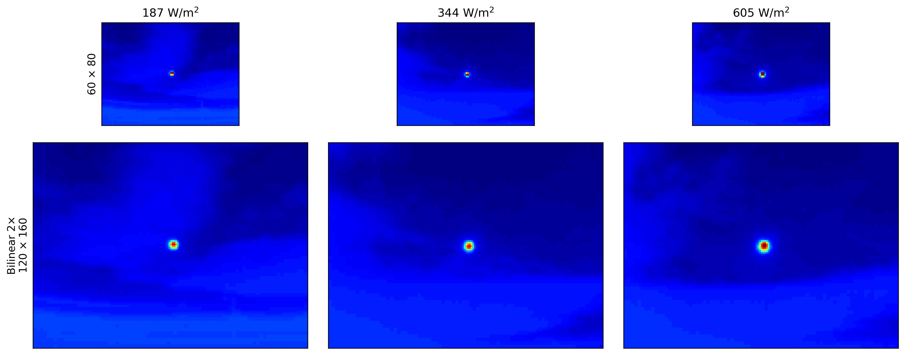
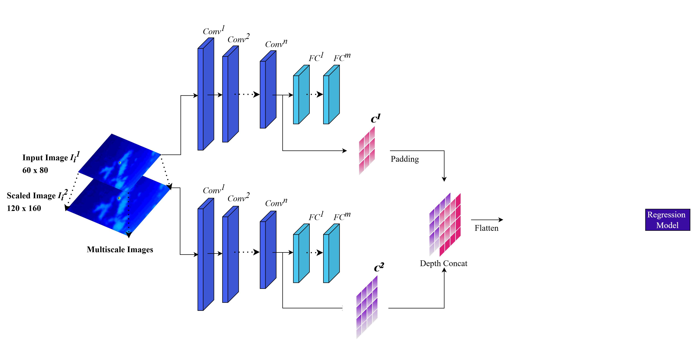
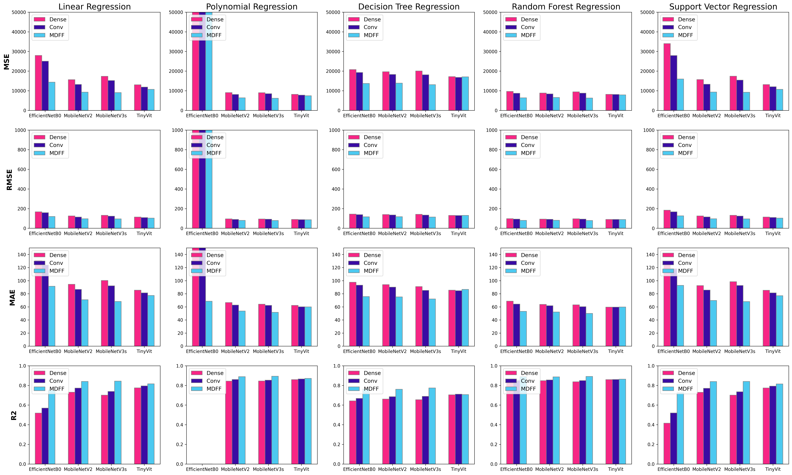
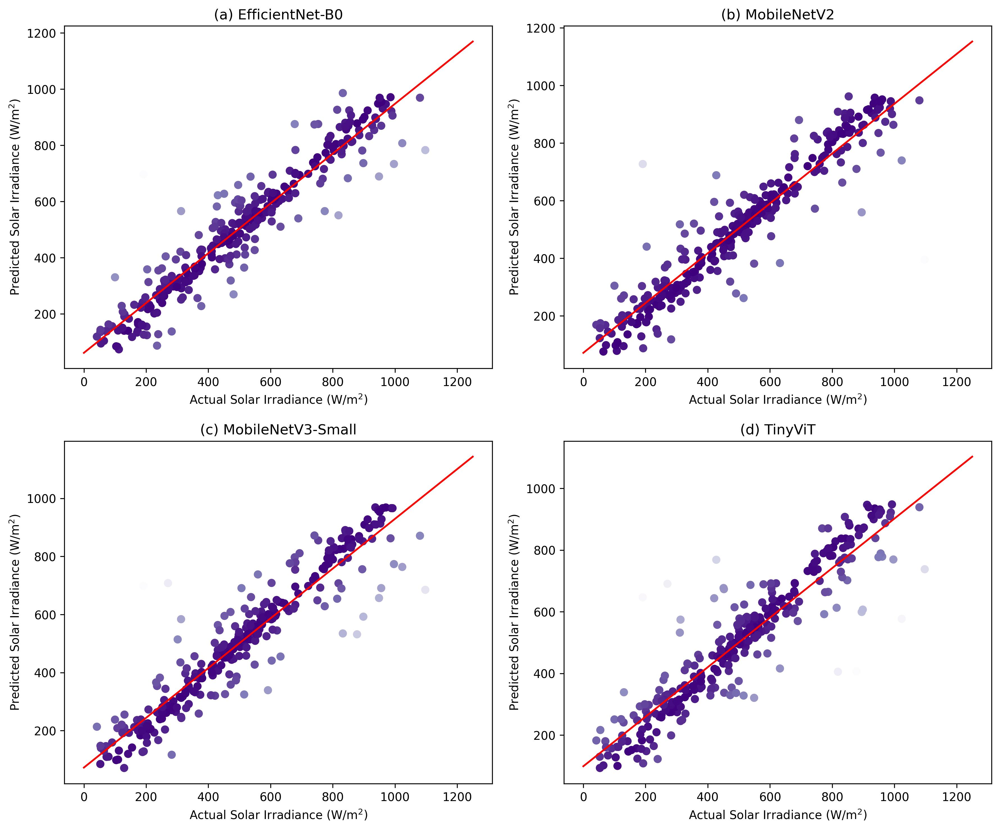

# Multiscale Deep Feature Fusion for Solar Estimation from Infrared Sky Images (AICS 2025)

[Ifran Rahman Nijhum](https://sites.google.com/view/ifran-rn), H. Hassan, [Paul Kenny](https://people.ucd.ie/paul.kenny), and [Soumyabrata Dev](https://soumyabrata.dev/)

[](https://zenodo.org/records/20837755)
[](https://datadryad.org/dataset/doi:10.5061/dryad.zcrjdfn9m)
[](https://pytorch.org/)
[](LICENSE)

#### News
- **Nov 2026:** This updated version fixes several bugs in the original code, follows the paper's input protocol (60×80 + bilinear 2×) and evaluates all 12 backbone/feature configurations on the **full Girasol dataset**. See [What's New vs. the Paper](#whats-new-vs-the-paper).
- **Jun 2026:** Paper published in the proceedings of the 33rd International Conference on Artificial Intelligence and Cognitive Science (AICS'25), Dublin. [Paper](https://doi.org/10.5281/zenodo.20837755)

<hr />

> **Abstract:** *Ground-based infrared (IR) sky images have proven to be effective in providing valuable insights for solar irradiance prediction. However, the low resolution and poor contrast act as barriers to effective feature extraction and accurate prediction. In this research, we propose a Multiscale Deep Feature Fusion (MDFF) strategy, tailored for improved and rich feature extraction from low-resolution IR images. The method first creates multiple scales of the original image using bilinear interpolation, followed by leveraging a pre-trained deep learning model for the feature extraction. The multiscale feature set is then fused utilizing a depth concatenation strategy. This fusion helps in improving the feature clarity as well as preserving essential structural details. Applying Principal Component Analysis (PCA) before training a lightweight regression model (e.g., Linear Regression, Random Forest) further optimizes the feature selection and reduces computational complexity and storage requirements to a great extent. Our extensive experiments not only demonstrate that the proposed feature fusion method outperforms using only dense-layer feature vector or single-scale convolutional feature maps of the feature extractor, but also provide an in-depth evaluation of the latest efficient architectures (e.g., MobileNet, EfficientNet, TinyViT) for infrared sky imaging. Our findings suggest that MobileNetV2 combined with Random Forest Regression and third-degree Polynomial Regression achieves the best prediction accuracy (R² of 0.90).*

<hr />

## What's New vs. the Paper

This repository is a slightly updated version of the published work. The original code was reorganised, and a few bugs and protocol inconsistencies were fixed along the way. The inputs now match the protocol described in the paper: the native 60×80 IR image plus one bilinearly upscaled 2× copy (120×160); the code behind the paper upscaled the images before feature extraction. Smaller-scale feature maps are now padded with each image's own mean (previously the mean of the whole batch). The EfficientNet-B0 dense-feature baseline now loads EfficientNet-B0 (it previously loaded MobileNetV3-Small), and the MobileNetV3-Small MDFF run saves its own outputs and trains all five regressors. Regressors use fixed random seeds, and features are processed in chunks so the full dataset fits in ~6 GB of RAM. Because of these changes, the numbers below differ slightly from the paper (best R² 0.894 here vs. 0.90 in the paper), but the main finding holds: MDFF features beat dense-layer and single-scale convolutional features on every backbone.

## Dataset

[Girasol](https://datadryad.org/dataset/doi:10.5061/dryad.zcrjdfn9m) (Terrén-Serrano et al., 2021) pairs ground-based infrared sky images (60×80) with global solar irradiance measurements from a pyranometer. This version uses all 498,265 labelled IR images.

<p align="center"></p>
<p align="center"><em>Colourised IR sky images at the two scales used by MDFF. The first row shows the original 60×80 images and the second row their bilinearly upscaled 2× copies (120×160). Titles give the measured irradiance.</em></p>

## Network Architecture

Each IR image and its bilinear 2× copy are passed through the same frozen, ImageNet-pretrained backbone. The feature maps of the last convolutional block are taken from both scales; the smaller map is centre-padded to the size of the larger one, and the two are concatenated along the channel (depth) dimension and flattened. Incremental PCA reduces the fused features to 20 components, which are used to train lightweight regressors: Linear Regression, Decision Tree, Random Forest, Linear SVR and third-degree Polynomial Regression.

<p align="center"></p>

Four backbones are evaluated (MobileNetV2, MobileNetV3-Small, EfficientNet-B0 and TinyViT-5M), each with three kinds of features:

- **Dense**: the pooled feature vector fed to the classifier
- **Conv**: the last convolutional feature maps of the original image (single scale)
- **MDFF**: the fused multiscale feature maps (proposed)

## Installation

```
git clone https://github.com/ifran-rahman/MDFF.git
cd MDFF
pip install -r requirements.txt
```

The pinned PyTorch build targets CUDA 13.0. For another CUDA version (or CPU), install `torch` and `torchvision` from the [PyTorch selector](https://pytorch.org/get-started/locally/) first, then install the remaining requirements.

## Training and Evaluation

The backbones are frozen and only used for inference, so "training" here means fitting PCA and the regressors on the extracted features.

1. Download [Girasol](https://datadryad.org/dataset/doi:10.5061/dryad.zcrjdfn9m) and place (or symlink) it at `data/Girasol`, so that images are found at `data/Girasol/<YYYY_MM_DD>/infrared/<timestamp>IR.png` and the labels at `data/Girasol/<YYYY_MM_DD>/pyranometer/<YYYY_MM_DD>.csv`.
2. Build the label file `data/girasol.csv.gz`, with one row per image (`name` = path relative to `data/Girasol`, `value` = irradiance in W/m²):

   ```python
   from Utils.dataset import load_dataset
   load_dataset('data/Girasol').sort_values('name').to_csv('data/girasol.csv.gz', index=False)
   ```

   The first 70% of rows are used for training and the remaining 30% for validation. The reported results used a split by day (165 training days and 74 validation days), so a split built from this sorted file gives slightly different numbers.
3. Run any of the 12 configurations:

   ```
   python Train/MobileNetV2/MobilenetMDDF/train.py
   ```

   Each script extracts the features, fits PCA and the five regressors, and prints MSE, RMSE, MAE and R² on the validation set. The reduced features (`Features/`) and fitted models (`models/`) are saved next to the script. An interrupted PCA fit resumes from its last checkpoint.
4. Generate the figures with [Results/results.ipynb](Results/results.ipynb). It reads each script's `train.log` (redirect the script output there, e.g. `python train.py > train.log`) and the saved features and models, and writes the figures to `Results/Figures/` and all metrics to [Results/results.csv](Results/results.csv).

<details>
<summary><strong>Configuration</strong> (click to expand)</summary>

`config.json` sets the data paths and the input normalisation (mean and std of the Girasol images, used for all backbones):

```json
{
  "data_root": "data/Girasol",
  "dataset": {
    "tiny": "data/tiny_girasol.csv",
    "full_dataset": "data/girasol.csv.gz",
    "mean": [0.3938, 0.3938, 0.3938],
    "std": [0.0242, 0.0242, 0.0242]
  }
}
```

Use `--dataset tiny` to run on a small subset CSV for a quick check, and `--config` to point to another config file.

| Setting | Value |
|---|---|
| Input scales | 60×80 and bilinear 2× (120×160) |
| Batch size | 128 |
| PCA | IncrementalPCA, 20 components, fitted on training data only |
| Regressors | Linear, Decision Tree, Random Forest, Linear SVR, Polynomial (degree 3); `random_state=42` |
| Runtime | 12–17 min per Dense/Conv run, 33–84 min per MDFF run (RTX 3060, full dataset) |
| Memory | ~6 GB RAM per run; each saved Random Forest model is ~3 GB |

</details>

Trained models are not included in this repository; running the scripts reproduces them.

## Results

<p align="center"></p>
<p align="center"><em>MSE, RMSE, MAE and R² of each regressor (columns) for Dense, Conv and MDFF features of each backbone.</em></p>

Results are on the validation set of the full Girasol dataset (348,785 training / 149,480 validation images). MDFF gives the best result on every backbone, and the best overall is MobileNetV3-Small MDFF with Polynomial Regression (R² 0.894); all metrics are in [Results/results.csv](Results/results.csv).

<details>
<summary><strong>Degree of fit</strong> (click to expand)</summary>

<p align="center"></p>
<p align="center"><em>Degree of fit between the actual and predicted irradiance values using the proposed method with Random Forest Regressor. (a), (b), (c) and (d) denote the performance while trained on EfficientNet-B0, MobileNetV2, MobileNetV3-Small, and TinyViT features.</em></p>

</details>

<details>
<summary><strong>One-day test</strong> (click to expand)</summary>

<p align="center"></p>
<p align="center"><em>Measured weather station data (in violet) and the predicted irradiance (in blue) as of 22-Jul-2018 (MobileNetV2 MDFF + Polynomial Regression; times in UTC). The zoomed-in inset reveals the model's ability to track even rapid fluctuations in irradiance.</em></p>

</details>

## Repository Structure

```
MDFF/
├── config.json              # data paths and input normalisation
├── requirements.txt
├── data/                    # Girasol images and label CSV go here (not included)
├── Utils/
│   ├── dataset.py           # Girasol dataset, label CSV builder, 70/30 split
│   ├── feature_extraction.py# forward hooks, multiscale extraction, padding and fusion
│   ├── process_features.py  # chunked extraction -> IncrementalPCA
│   ├── evaluate.py          # regressors and metrics
│   └── device.py
├── Train/
│   ├── MobileNetV2/         # MobilenetMDDF, MobileConv, MobileNetDense
│   ├── MobileNetV3s/        # MobilenetMDDF, MobileConv, MobileDense
│   ├── EfficientNetB0/      # EfficientNetMDDF, EfficientNetConv, EfficientNetDense
│   └── TinyVIT/             # TinyVitMDFF, TinyVitConv, TinyVitDense
├── Results/
│   ├── results.ipynb        # generates all figures
│   ├── results.csv          # all metrics
│   └── Figures/
└── assets/                  # architecture figure
```

## Citation

If you use MDFF, please consider citing:

```
@inproceedings{nijhum2026mdff,
  title     = {Multiscale Deep Feature Fusion for Solar Estimation from Infrared Sky Images},
  author    = {Nijhum, I. R. and Hassan, H. and Kenny, P. and Dev, S.},
  booktitle = {33rd International Conference on Artificial Intelligence and Cognitive Science (AICS'25)},
  address   = {Dublin},
  year      = {2026},
  month     = jun,
  publisher = {Zenodo},
  doi       = {10.5281/zenodo.20837755}
}
```

## Contact

Should you have any questions, please contact ifran.nijhum@ucdconnect.ie or devs@tcd.ie.

## Our Related Works

- On Improving Solar Forecasts with Enhanced IR Imaging and CNNs, IMVIP 2024. [Paper](https://doi.org/10.1049/icp.2024.3289) | [Code](https://github.com/ifran-rahman/Solar_Enhanced_IR)
- Intra-Hour Solar Irradiance Estimation Using Infrared Sky Images and MobileNetV2-Based CNN Regression, EI² 2023. [Paper](https://doi.org/10.1109/EI259745.2023.10512911) | [Code](https://github.com/ifran-rahman/solar-irradiance-estimation-dl)
- Enhancing Intra-Hour Solar Irradiance Estimation through Knowledge Distillation and Infrared Sky Images, IGARSS 2024. [Paper](https://doi.org/10.1109/IGARSS53475.2024.10642288) | [Code](https://github.com/ifran-rahman/Solar_Estimation_KD)
- Optimizing Lightweight Photovoltaic Forecasting Models: A Distillation Approach, IGARSS 2025. [Paper](https://doi.org/10.1109/IGARSS55030.2025.11313980) | [Code](https://github.com/ifran-rahman/SOLAR_FORECASTING_KD)
